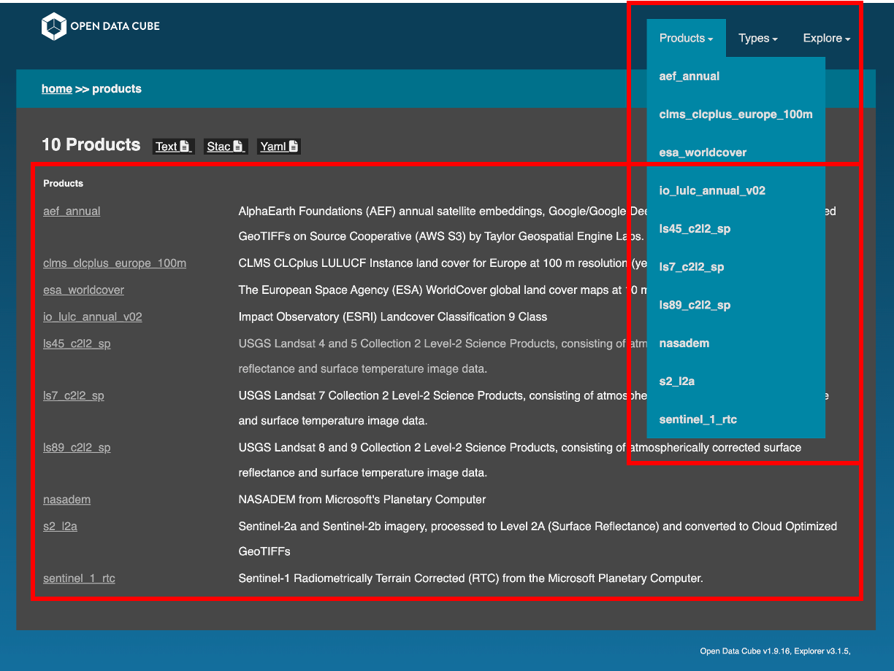
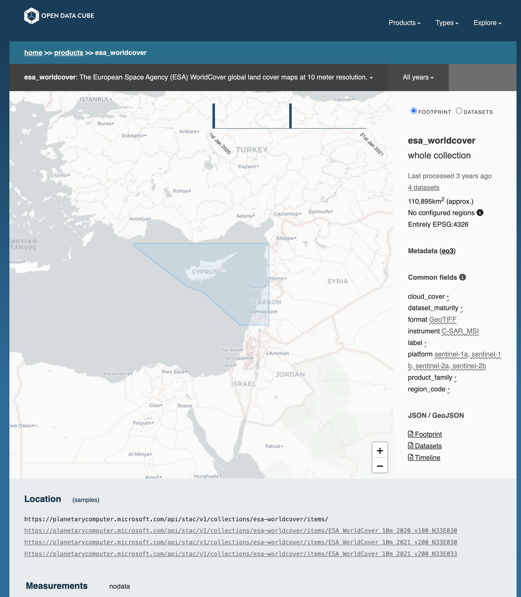
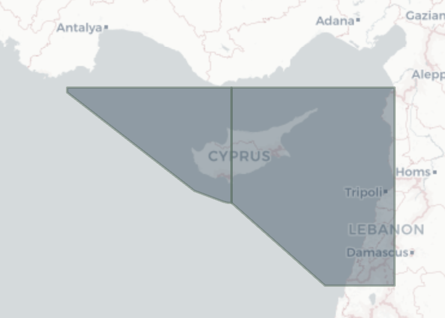
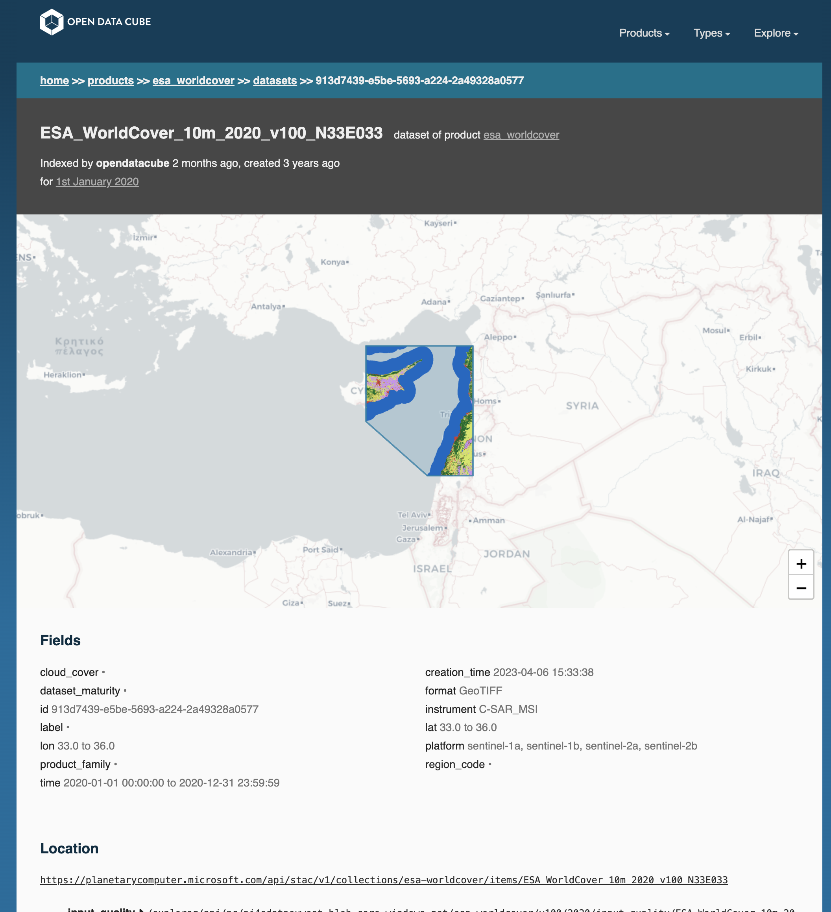
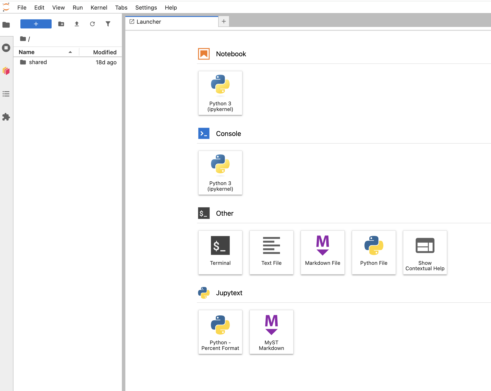
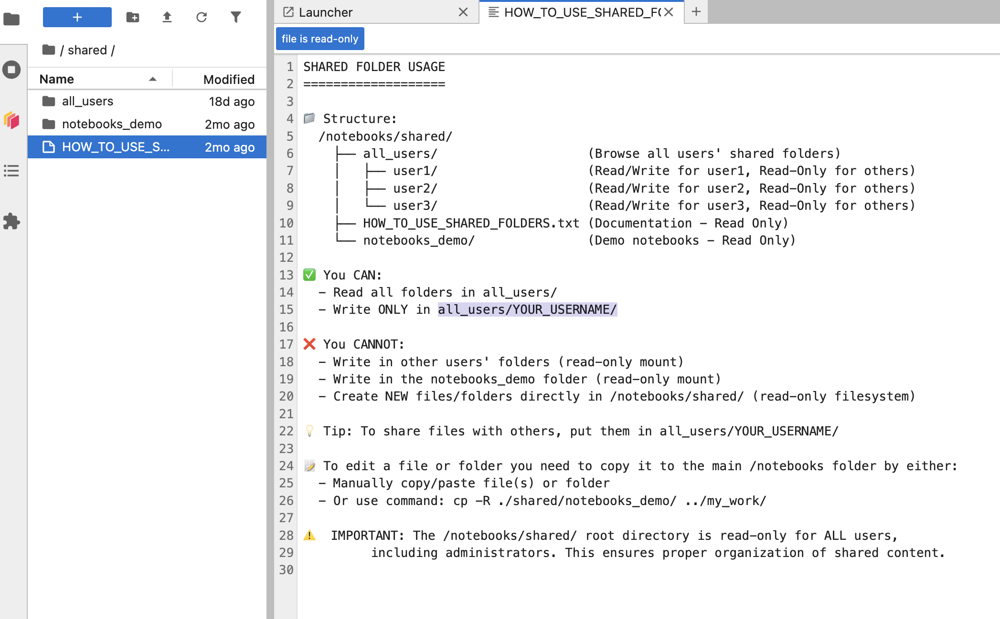
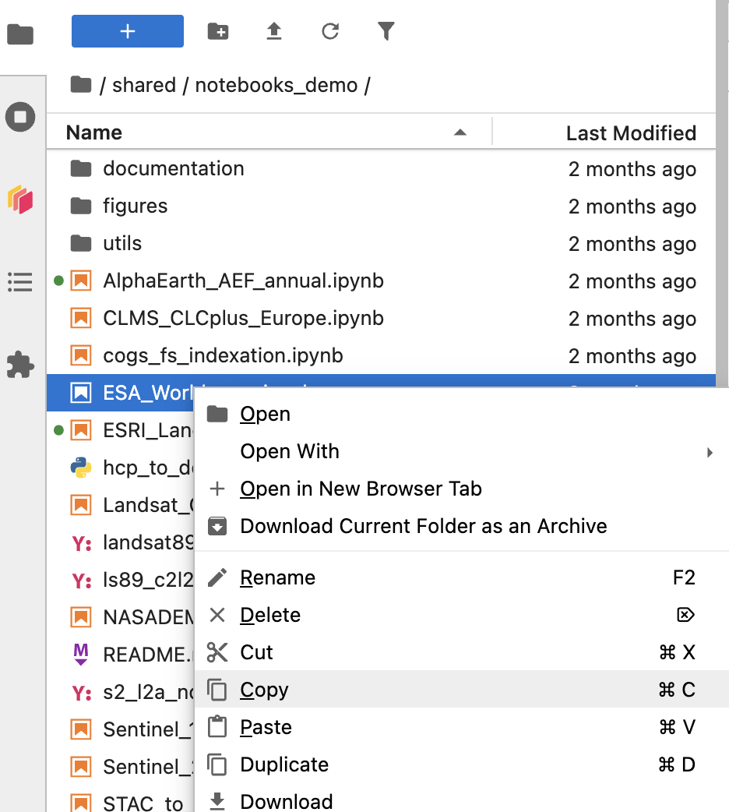
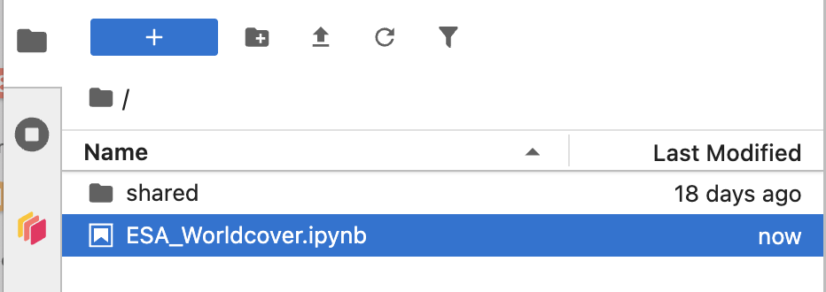
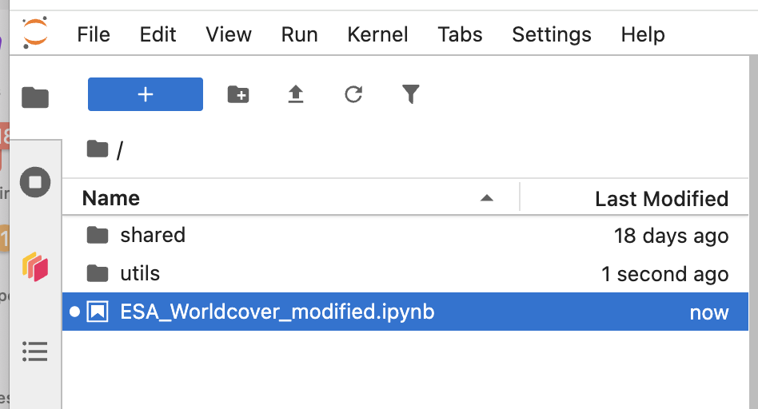

Several instances of cube-in-a-box have been deployed in the frame of the Nostradamus project, following the usual [cube-in-a-box installation procedure](1_install_odc) :

-   [Cyprus](https://cyprus-dc.nostradamus-platform.eu/explorer/products){target="_blank"}

-   [Germany](https://germany-dc.nostradamus-platform.eu/explorer/products){target="_blank"}

-   [Slovenia](https://slovenia-dc.nostradamus-platform.eu/explorer/products){target="_blank"}

-   [Serbia](https://serbia-dc.nostradamus-platform.eu/explorer/products){target="_blank"}

-   [Switzerland](https://switzerland-dc.nostradamus-platform.eu/explorer/products){target="_blank"}

In order to describe how to use one of the installed Nostradamus datacubes, the example of the Cyprus one will be taken.

## Accessing the datacube explorer part

The explorer part of the datacube is the Graphical User Interface, that allows to see the content and download data. E.g. for Cyprus datacube: <https://cyprus-dc.nostradamus-platform.eu/explorer>

### **Products**

In the datacube explorer part, the available products ([data sources installed for the Nostradamus project](nostradamus_datacube_data_sources)) are displayed in the default page and correspond to the "Products" menu.

{width="558"}

Clicking on one of the products (e.g. "esa_worldcover" in the screenshot below) will open a new page containing all relevant information about the dataset:

{width="552"}

-   **Years** available in a dropdown list: the years (and months when a year is selected) of data availability for the product selected in the datacube, can be selected. By default it is set on "All"

-   **Footprint** or **Datasets** switch:

    -   **Footprint**: it shows on the map the total fooprint of the datasets

    -   **Datasets**: it shows individually each dataset's footprint; in the case of Cyprus, two footprint extents are available

{width="541"}

When clicking on one dataset, it opens a new page specific to the dataset in question containing a thumbnail, metadata, various links for accessing it. The link "**map**" in the "location" section allows to download the geotiff.

{width="536"}

**Notice**:

The urls on datasets pages are signed (e.g. they end with [`?sig=.eJwVyrEOwiAQANB_YZej4NTNmI66dHC8XMsZSW`](https://cyprus-dc.nostradamus-platform.eu/explorer/api/pc/ai4edataeuwest.blob.core.windows.net/esa-worldcover/v200/2021/map/ESA_WorldCover_10m_2021_v200_N33E033_Map.tif?sig=.eJwVyrEOwiAQANB_YZej4NTNmI66dHC8XMsZSWghcC2D8d8N83tfdZSoRvURyXUEoHBlT0J8NK6il5gWvabCuoXdp1b1zgJc6dJSiX5NJxc4rTFgjR1gowzTfMNXx3tHHMyG3bAvfDo3GefwQVlLeKvfH1LsKzs.as-FkA.swxExQsjSpbCKWbTaSNmfLPaZlY)`...`\`). As signature are only valid for a limited period of time (less than 1 hour in Planet Computer). You might need to refresh the page in case a link returns an error, to regenerate a valid signature. Meaning direct urls for files cannot be saved "for later use" or sent by email.

### **Types**

The "Types" dropdown menu correspond to the **metadata types**, that describe the structure of the YAML/JSON document accompanying each dataset. The following types area available:

-   **eo**: Legacy Earth Observation metadata format from early ODC versions, with deeply nested fields and full source-dataset lineage embedded in each document. Superseded by eo3 and no longer recommended for new products.

-   **eo3**: Current STAC-inspired metadata format with flat properties, an explicit CRS and geometry, and lineage referenced by dataset ID. It is the standard, fully supported format since datacube-core 1.9.

-   **telemetry**: Metadata format for raw (level-0) satellite downlink data, describing acquisitions by satellite, sensor, orbit, ground station and pass times. It has no spatial grid for raster loading and is now obsolete.

=\> the **eo3 type** should then be preferred

### **Explore**

The "Explore" dropdown menu gives access to the following functionalities:

-   **Recently added**: it displays the available products by reverse-chronological order of addition into the datacube

-   **Storage**: it lists the stored products in the datacube and allows to access them directly through hyperlinks

-   **Metadata issues**: it is an audit tool that flags products whose dataset metadata Explorer can’t fully use, such as missing or invalid footprints, CRS, dates or summaries, so these can be fixed and re-indexed.

-   **Products overview**: it lists every product indexed in the datacube with its key details, such as license type, default CRS and default resolution, giving a quick summary of what the cube contains.

-   **Dataset counts**: it is an audit view that shows the raw number of indexed datasets per product, broken down by period (e.g. year and month)

-   **About explorer:** it describes the Explorer instance and lists the URLs for downloading its products, metadata types and dataset documents, along with its APIs (footprints, regions, datasets, STAC) and the CSV/text versions of its audit pages.

## Accessing the Jupyter notebooks part

The goal for the Nostradamus applications developpers is to use the Jupyter notebooks part of the Data Cubes to:

1.  discover available products and learn how to interact with them through demo jupyter notebooks
2.  develop their own notebooks

### Authorization for using an existing datacube

***Only the persons who are whitelisted by the datacube administrator can create an account on the given datacube.!***

1.  Contact by email the Nostradamus datacube's instance administrator who will give you a username
2.  Once you have received your username, go to <https://cyprus-dc.nostradamus-platform.eu/jupyter>, where you will need to click on "Sign Up" in order to setup your password
3.  Then, go back to the login page and sign in; you will reach the following page

{width="499"}

4.  Double-click on the "shared" folder and have a look at the "HOW_TO_USE_SHARED_FOLDERS.txt" file describes how to use it. Keep it mind that you can **only write in all_users/YOUR_USERNAME/** but you can read in all folders of the other users

    {width="492"}

### Use of existing notebooks

The existing demo notebooks are all contained in the `/shared/notebooks_demo/` folder. For an overview of the way to use the notebooks, look at the section "Exploring the demo notebooks" of the [How to use an Open Data Cube](2_use_odc.qmd) page.

Beginners in Jupyter notebook are recommended to copy the whole `notebooks_demo` folder to their root directory in order to have a local copy of the notebooks and be able to edit them (as they will be read-only in the shared folder).

In order to develop your own notebook based on an existing one, copy the one of interest to the root directory first (or shared personal directory), which will allow you to edit and save it. To do so, right click on the notebook of interest and its dependencies (folders documentation, figures, utils) in the “notebooks_demo” folder and paste it at the root directory or your own folder.

{width="420"}

{width="521"}

{width="521"}